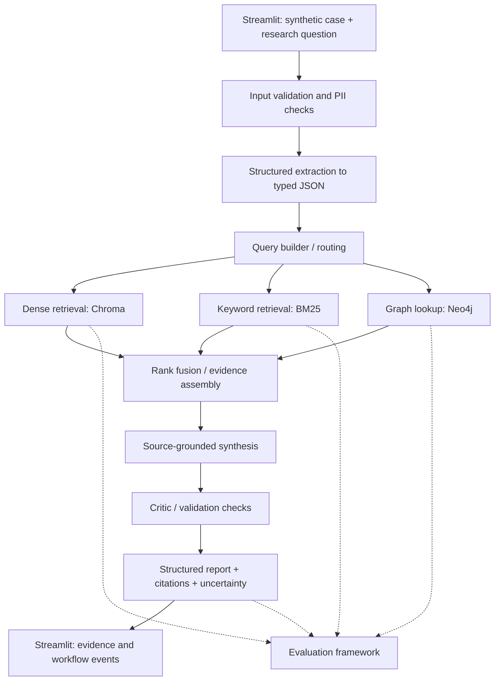

# MindGraph-RAG

**An explainable, evidence-grounded Hybrid RAG + Knowledge Graph research prototype for structured psychological case analysis.**

MindGraph-RAG explores whether combining **dense and keyword retrieval**, **explicit graph relationships**, and **auditable, multi-step workflows** improves the quality and transparency of answers to questions about *synthetic* psychological case narratives.

> **Project status:** Planning / initial implementation. The architecture and roadmap below describe **planned capabilities, not features already built**. At present, the repository contains documentation and configuration only.
>
> **Safety boundary:** This is an educational and research prototype, **not** a medical device, clinical diagnostic system, therapy tool, or substitute for qualified professionals. It must not produce definitive diagnoses, treatment plans, or emergency advice. Initial development uses synthetic, non-identifiable cases.

## 1. Motivation and research questions

Ordinary RAG retrieves semantically similar text, but multi-constraint case questions may also depend on time course, missing information, contextual factors, exclusions, and whether a claim is supported by a specific source. Semantic similarity alone does not guarantee that these conditions are checked.

MindGraph-RAG tests a modular approach rather than assuming that more components automatically produce better answers:

1. **Does hybrid retrieval outperform dense-only retrieval** on a curated evaluation set?
2. **Does adding graph-based relationship and constraint lookup improve coverage and consistency** for multi-hop and exclusion-focused questions?
3. **Does a structured review / critic step reduce unsupported claims** without introducing excessive latency?
4. **Can users inspect the evidence and decision checkpoints** underlying each output without exposing private model chain-of-thought?

A successful project should report where each component **helps, hurts, or makes no measurable difference**.

## 2. Intended scope

### In scope

- De-identification checks and structured information extraction from **synthetic** case narratives.
- Retrieval from a small, versioned corpus of **legally usable, traceable** educational and scientific sources.
- Dense vector search, BM25 search, and reciprocal-rank-fusion (RRF) hybrid retrieval.
- An **explicitly curated** graph of concepts, symptoms, relationships, evidence references, and selected non-diagnostic decision constraints.
- Separate retrieval routes for document evidence and graph facts, combined with source-aware answer generation.
- Missing-information flags, uncertainty statements, evidence citations, and auditable workflow events.
- Evaluations and ablation comparisons of progressively more capable baselines.
- A local-first developer experience, API, and an interactive demo.

### Out of scope (especially for the initial versions)

- Diagnosis, differential diagnosis as medical advice, individualized treatment recommendations, or risk scoring for real patients.
- Ingestion, storage, or processing of real clinical records or identifiable patient information.
- Claiming clinical validation from synthetic-case tests.
- Reproducing proprietary DSM-5/DSM-5-TR content without appropriate permissions.
- Treating LLM-generated knowledge graph edges as verified clinical facts.

**Terminology note:** The original concept mentioned a “DSM-5 graph.” In this revised plan, the graph is based on **licensed/permission-compatible, source-attributed conceptual knowledge**. Any formal DSM content may be added only if usage rights and expert review allow it; an official DSM graph is **not** assumed.

## 3. Proposed architecture



The diagram represents the **target state**; components will be implemented and tested incrementally. The first usable baseline deliberately omits graph lookup and multi-agent orchestration.

### Data flow and contracts

1. **Validate and sanitize:** reject unsuitable inputs, apply basic PII checks, and surface warnings. Automated masking is not a privacy guarantee.
2. **Extract:** convert explicit statements into a versioned Pydantic schema, retaining source spans and distinguishing `unknown` from `absent`.
3. **Retrieve:** independently gather document passages (dense/BM25) and, later, graph facts linked to traceable sources.
4. **Assemble evidence:** deduplicate, merge rankings (e.g., RRF), and track document IDs, versions, and passage locations.
5. **Synthesize:** answer the research question using retrieved evidence; abstain or mark uncertainty if support is insufficient.
6. **Validate:** check citation existence, schema conformance, contradictions, missing information, and unsupported assertions.
7. **Present:** show source excerpts, graph paths when available, checks passed/failed, and workflow-event summaries (**not hidden model reasoning traces**).

### Example structured extraction (illustrative, not implemented)

```json
{
  "case_id": "SYN-001",
  "symptoms": [
    {"concept": "sleep_disturbance", "evidence_span": "difficulty sleeping"},
    {"concept": "difficulty_concentrating", "evidence_span": "trouble focusing"}
  ],
  "duration": {"value": 3, "unit": "weeks", "status": "reported"},
  "functional_impact": "unknown",
  "missing_information": ["symptom_frequency", "relevant_medical_context"],
  "diagnosis": null
}
```

## 4. Technology choices (proposed, subject to experiments)

| Layer | Preferred starting point | Purpose / trade-off |
| --- | --- | --- |
| Language | Python 3.11+ | Typed, testable modules |
| Structured schemas | Pydantic | Validate inputs, outputs, and explicit unknowns |
| Local model runtime | Ollama + a suitable quantized model | Low-cost local prototyping; model-dependent quality |
| Embeddings | Sentence Transformers | Reproducible embeddings; evaluate multilingual support if needed |
| Vector index | Chroma | Simple local dense retrieval |
| Sparse retrieval | BM25 (`rank-bm25` or equivalent) | Keyword-sensitive retrieval |
| Fusion | Reciprocal Rank Fusion (RRF) | Combine ranked retrieval results |
| Graph database | Neo4j | Named entities, relationships, provenance, constraints |
| Workflow orchestration | LangGraph (when justified) | Explicit state and inspectable workflow steps |
| Integrations | LangChain components (optional) | Use selectively rather than adding unnecessary dependencies |
| API | FastAPI | Separate core logic from user interface |
| Demo | Streamlit | Case input, retrieved evidence, graph paths, validation summary |
| Automated tests | pytest | Unit, integration, and regression tests |
| Retrieval / answer evaluation | Custom labeled tests; Ragas where appropriate | Grounding, relevance, citation integrity, error analysis |
| Developer automation | GitHub Actions (later) | Run tests and lint on every change |

**Local-first is a preference, not a requirement.** Model selection will reflect hardware limits, retrieval language, accuracy, and resource usage. Avoid hardcoding a model provider: wrap generation and embedding backends behind small interfaces.

## 5. Milestone-based roadmap (no fixed timeline)

Each stage has a **learning objective**, **implementation tasks**, **deliverables**, and an explicit **definition of done**. Progress to the next stage only after the current stage works and its limitations have been documented.

### Stage 0 — Foundations and reproducibility

**Learn:** Repository hygiene, virtual environments, configuration, modular architecture, testing, and responsible dataset use.

- [ ] Initialize `src/` project structure, Python environment, `pyproject.toml`, `.env.example`, and `.gitignore`.
- [ ] Document run commands, data provenance policy, architecture decisions, and non-clinical usage boundaries.
- [ ] Introduce pytest, formatting/linting, logging, and deterministic configuration where possible.
- [ ] Create a minimal synthetic-case fixture set and a machine-readable dataset manifest.
- [ ] Define input/output contracts and an `unknown` / `not reported` convention.

**Deliverables:** Importable project skeleton, runnable smoke test, sample cases, basic developer guide.

**Done when:** Another developer can clone the project, install dependencies, and run passing smoke tests using documented commands.

### Stage 1 — Safe, structured case intake

**Learn:** Information extraction, schema design, source spans, robustness, and privacy boundaries.

- [ ] Validate synthetic case input and flag potential identifiers; never silently claim full anonymization.
- [ ] Implement a simple rule-based extraction baseline before introducing an LLM extractor.
- [ ] Implement LLM-assisted extraction with schema validation and retry/failure handling.
- [ ] Record evidence spans, missing fields, ambiguity, and source-to-field mappings.
- [ ] Write tests for incomplete, contradictory, multilingual, and malformed cases.

**Deliverables:** CLI or Python function producing validated structured JSON and test cases.

**Done when:** Outputs pass schema validation, do not invent unreported fields in the test fixtures, and surface extraction failures rather than silently guessing.

### Stage 2 — Document corpus and basic dense RAG

**Learn:** Corpus licensing, preprocessing, chunking, embeddings, top-k retrieval, and prompt grounding.

- [ ] Select a small set of openly usable and verifiable educational / scientific sources.
- [ ] Record document title, author/publisher, URL, publication/version date, and usage terms.
- [ ] Build repeatable parsing, chunking, metadata, and Chroma indexing jobs.
- [ ] Implement dense retrieval and a baseline answer generator with evidence references.
- [ ] Create a question set with annotated relevant passages for evaluation.
- [ ] Explicitly handle “insufficient evidence” cases.

**Deliverables:** End-to-end dense-only RAG baseline with reproducible indexing and citations.

**Done when:** Retrieved passages can be inspected, answers point to actual stored passages, and baseline retrieval metrics are recorded.

### Stage 3 — Hybrid retrieval and ranking experiments

**Learn:** Sparse vs. dense retrieval, fusion, relevance judgments, and retrieval error analysis.

- [ ] Add BM25 over the same indexed corpus.
- [ ] Compare BM25-only and dense-only retrieval on the same queries.
- [ ] Combine the rankings using RRF; make top-k and RRF parameters configurable.
- [ ] Add citation-preserving deduplication and basic query rewriting only if tests justify it.
- [ ] Evaluate Recall@k, MRR, and nDCG where suitable; inspect failed queries.

**Deliverables:** Configurable hybrid retriever and retrieval experiment report.

**Done when:** Baseline vs. hybrid metrics and examples are reproducible, including cases where hybrid retrieval performs worse.

### Stage 4 — Curated knowledge graph and GraphRAG

**Learn:** Property graphs, entity normalization, Cypher, provenance, graph traversal, and constraint design.

- [ ] Define a **small, well-scoped domain** and a graph schema before importing data.
- [ ] Start with curated concept nodes and traceable edges (e.g., `SYMPTOM`, `CONCEPT`, `SOURCE`, `RELATED_TO`, `SUPPORTED_BY`).
- [ ] Include source IDs, edge meaning, source version, and review state; distinguish source claims from system rules.
- [ ] Create Neo4j uniqueness constraints, repeatable seed data, and tested Cypher queries.
- [ ] Add graph lookup as a separate retrieval route rather than replacing literature retrieval.
- [ ] Show which graph paths support an answer, and identify unknown or unsupported relationships.
- [ ] Test graph-based answers against curated reference cases.

**Deliverables:** Small, source-linked knowledge graph and hybrid + graph evidence assembler.

**Done when:** Example graph queries, graph provenance, and additional performance/coverage relative to Stage 3 are verifiable.

### Stage 5 — Stateful workflow and critical checks

**Learn:** Orchestration, separation of responsibilities, deterministic checks, and error recovery.

- [ ] Implement an explicit shared state and steps: extraction → routing → retrieval → synthesis → validation.
- [ ] Use LangGraph only where conditional branches, retries, or tool coordination provide measurable value.
- [ ] Add rule-based checks first: schema validity, citation IDs, contradictory fields, and missing information.
- [ ] Add an optional model-based critic for supportedness and consistency; never trust its output without tests.
- [ ] Track failures, retry counts, prompt/model versions, latency, and token usage where available.

**Deliverables:** Tested orchestration workflow and evidence validation report.

**Done when:** Failures are explicit, workflow events are inspectable, and the review step's benefits/costs are measured.

### Stage 6 — API and explainable UI

**Learn:** Service interfaces, presentation of uncertainty, and practical debugging UX.

- [ ] Expose input validation and analysis endpoints through FastAPI.
- [ ] Build a Streamlit demo for **synthetic cases only**.
- [ ] Show structured extracted facts, missing information, ranked passages, citations, and graph paths.
- [ ] Show a compact **audit trail of observable steps and validation outcomes**, not hidden chain-of-thought.
- [ ] Include unambiguous research-only disclaimers, clear error messages, and no persistence of personal information by default.

**Deliverables:** Local end-to-end demo with separated API and interface.

**Done when:** A new user can run the sample-case demo and inspect exactly which evidence supported or failed to support each answer.

### Stage 7 — Evaluation, ablations, and reliability

**Learn:** Experiment design, fair baselines, failure taxonomy, and reproducibility.

- [ ] Freeze and version an evaluation dataset, evaluation prompts, and corpus snapshot.
- [ ] Compare the same cases and settings across configurations:
  - **A:** Dense-only RAG
  - **B:** Hybrid RAG (dense + BM25)
  - **C:** Hybrid RAG + graph retrieval
  - **D:** Hybrid RAG + graph retrieval + critic
- [ ] Measure retrieval quality, citation validity, evidence groundedness, missing-information handling, and refusal/abstention behavior.
- [ ] Measure latency and resource usage; manually inspect representative errors.
- [ ] Guard against data leakage between test questions, indexed documents, and generated expected answers.
- [ ] Document outcomes neutrally, including negative results and unresolved risks.

**Deliverables:** Versioned benchmark scripts, comparison tables, error-analysis report.

**Done when:** Experiments can be rerun and claims in the README are supported by actual recorded results.

### Stage 8 — Packaging, documentation, and portfolio release

**Learn:** Reproducible engineering handoff, CI, model/data cards, and communicating research findings.

- [ ] Add setup troubleshooting and examples, architecture and data-flow docs, and meaningful test coverage.
- [ ] Configure CI for tests and linting; add safe sample data only.
- [ ] Document source licenses, model limitations, intended use, and failure modes.
- [ ] Record architectural decisions and benchmark findings.
- [ ] Prepare a concise demo video or screenshots and an engineering write-up.

**Deliverables:** Reproducible portfolio-ready research prototype, not a clinically validated product.

**Done when:** A reader can understand the trade-offs, reproduce key experiments, and run the demo from repository instructions.

## 6. Evaluation plan

| Dimension | Illustrative measures | Key caveat |
| --- | --- | --- |
| Retrieval | Recall@k, MRR, nDCG@k | Requires manually labeled relevant evidence |
| Citation integrity | Existing-source and correct-span rate | A citation can exist without supporting the claim |
| Evidence groundedness | Human-reviewed support labels; optional automated judge | LLM-as-judge is imperfect |
| Extraction quality | Field precision/recall, missing-field accuracy | Define labeling rules before scoring |
| Constraint handling | Coverage and correctness on expert-reviewed synthetic tests | Not a clinical safety certification |
| Uncertainty | Unsupported-answer rate, correct abstention rate | Must include unanswerable cases |
| Engineering | Latency, memory/VRAM, failure rate, cost | Compare under matched settings |

**Evaluation principles:** Keep model, corpus, and questions comparable across ablations. Separate deterministic citation/schema checks from subjective answer-quality grading. Never report diagnostic accuracy without properly designed clinical validation.

## 7. Proposed repository structure

```text
MindGraph-RAG/
├── README.md
├── .gitignore
├── .env.example                 # future; never commit actual secrets
├── pyproject.toml               # future
├── configs/                     # example configuration, no credentials
├── data/
│   ├── synthetic/               # safe examples only
│   └── manifests/               # provenance and dataset metadata
├── docs/
│   ├── architecture.md
│   ├── decisions/
│   └── evaluation.md
├── scripts/                      # indexing, seed graph, experiment runners
├── src/mindgraph_rag/
│   ├── intake/                   # validation, masking, extraction
│   ├── corpus/                   # loading, cleaning, chunking
│   ├── retrieval/                # dense, BM25, fusion
│   ├── graph/                    # graph schema and queries
│   ├── workflows/                # orchestration, state, critic
│   ├── generation/               # prompts and synthesis
│   ├── evaluation/               # metrics and benchmark helpers
│   ├── api/                      # FastAPI
│   └── core/                     # settings, logging, shared schemas
├── app/                          # Streamlit UI
├── tests/
│   ├── unit/
│   ├── integration/
│   └── fixtures/
└── experiments/                  # configurations and reproducible results
```

> This is the **target layout**. Directories and modules should be created as their stages begin, not generated as empty scaffolding all at once.

## 8. Development approach: ChatGPT + Cursor + human review

AI coding assistants will accelerate implementation, but architectural decisions and acceptance tests remain human-reviewed.

1. **Plan with ChatGPT:** break the current stage into small tasks; discuss concepts, trade-offs, input/output contracts, and test cases.
2. **Implement with Cursor:** make narrowly scoped changes in the local repository; provide relevant file context and acceptance criteria.
3. **Review and understand:** inspect every generated change, request explanations for unfamiliar code, and challenge unnecessary abstraction.
4. **Run and test locally:** use the documented environment, unit/integration tests, and small synthetic fixtures.
5. **Debug deliberately:** share exact errors and minimized relevant files, not credentials or personal case histories.
6. **Record decisions:** note why a design was chosen and what experiment would change it.
7. **Commit a completed increment:** commit only after its tests and documentation are updated.

**Practical rule:** Start with the smallest working baseline. Do not add a framework, database, agent, or model unless its purpose is explicit and its effect can be evaluated.

## 9. Responsible use and licensing

- Use **synthetic narratives** for development and demonstrations. Do not submit actual patient records to an LLM or hosted service.
- PII masking is a defense-in-depth measure, **not proof of anonymization**.
- Record source provenance and comply with the terms of scientific papers, guidelines, and taxonomies.
- **DSM-5 and DSM-5-TR are copyrighted**; this repository does not redistribute their diagnostic criteria or claim authorization to do so.
- Graph edges and extracted statements must be linked to licensed/public sources and, where needed, domain-expert review.
- Display uncertainty and missing information; avoid definitive medical claims.
- Do not publish case-level prompt logs, secrets, tokens, or licensed document text without permission.

## 10. Current progress

| Component | Status |
| --- | --- |
| Concept and revised architecture | Documented |
| Milestone-based roadmap | Documented |
| Source code / extraction pipeline | Not started |
| Dense and hybrid retrieval | Not started |
| Knowledge graph | Not started |
| LangGraph workflow | Not started |
| API and UI | Not started |
| Evaluations / benchmark results | Not started |

**Next milestone:** **Stage 0 — Foundations and reproducibility.** The first practical deliverable is a project that another person can install and smoke-test with a single synthetic fixture.

## 11. Long-term vision

MindGraph-RAG aims to become an **inspectable research environment** for studying how information extraction, document retrieval, graph evidence, and validation workflows interact on complex case-like questions. The central outcome is not an automated diagnosis, but a reproducible demonstration of **what evidence was found, which constraints were checked, what remains unknown, and whether additional architectural complexity is justified by measured results**.
